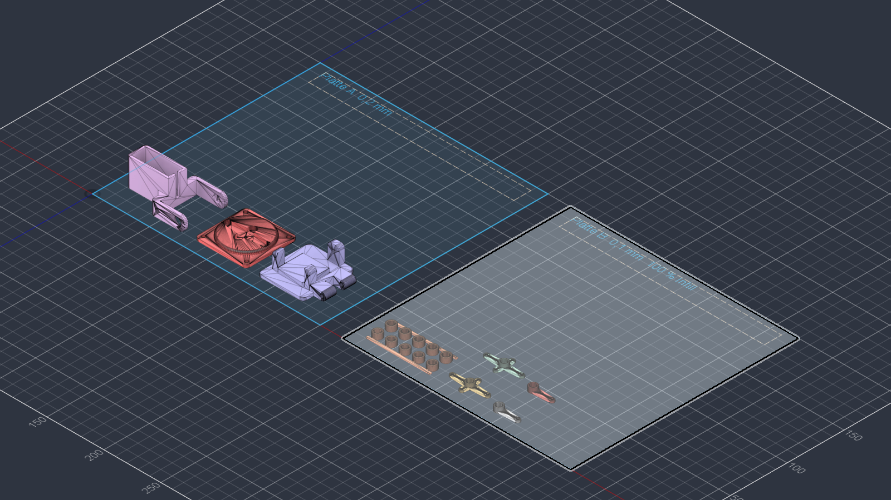

# Bionisches Kameraauge mit NVIDIA Jetson

Eine Pan-Tilt-Kamera folgt einem farbigen Ball. Sie bewegt sich dabei nach dem Vorbild des menschlichen Auges: ruhige Folgebewegung bei kleinen Abweichungen, schnelle Sakkade bei großen Sprüngen und Fixation, wenn das Ziel in der Mitte liegt.

*English: A bio-inspired pan-tilt camera eye on an NVIDIA Jetson Orin Nano. It tracks a colored ball using smooth pursuit, saccades and fixation, modeled on human eye movements.*



> Foto und Demo-Video vom fertigen Aufbau folgen.

## Projektstand

| Baustein | Stand |
|---|---|
| Jetson eingerichtet (JetPack 6.2, L4T 36.5), I²C-Bus 7 | erledigt |
| Webcam (Logitech C270) und Livebild mit OpenCV | erledigt |
| Ballerkennung per HSV-Farbschwelle, Werte gemessen | erledigt |
| Pan-Tilt-Halter V2 und Servohörner in Fusion angepasst, Druckdateien | erledigt |
| Servoansteuerung über PCA9685 (I²C) | in Arbeit |
| Regelkreis schließen: Kamera folgt dem Ball | in Arbeit |
| Messungen: Latenz, Sakkaden, Folgefehler | geplant |
| Version 2: Objekterkennung mit YOLO/TensorRT statt Farbball | geplant |

## Bionischer Ansatz

Das Projekt folgt dem Vorgehen der Bionik: Vorbild verstehen, Prinzip abstrahieren, technisch umsetzen, mit dem Vorbild vergleichen.

| Menschliches Auge | Umsetzung im Projekt |
|---|---|
| Augenmuskeln für horizontale und vertikale Blickbewegung | Pan-Servo (Kanal 0) und Tilt-Servo (Kanal 1) |
| Fixation: kleine Abweichungen werden toleriert | Totzone von 1° ohne Korrektur |
| Folgebewegung (smooth pursuit) | I-Regler auf den Blickfehler |
| Sakkade: schneller Sprung zum neuen Ziel | Sprung direkt auf den Zielwinkel ab 8° Fehler |
| Sakkadische Suppression: Wahrnehmung während der Sakkade gedämpft | Kamerabilder werden kurz ignoriert, bis der Servo angekommen ist |

Bionisch ist hier also nicht das Aussehen, sondern die Blicksteuerung. Als nächster Schritt sollen Latenz und Folgeverhalten gemessen und mit Werten vom Menschen aus der Literatur verglichen werden.

## Regelung

Die Kamera sitzt auf den Servos und bewegt sich mit. Der Blickfehler im Bild ist deshalb direkt der Regelfehler. Pro Kamerabild (Abtastzeit ca. 33 ms bei 30 fps) wird der Sollwinkel nachgeführt:

$$u_k = u_{k-1} + g \cdot e_k$$

Dabei ist $u_k$ der Sollwinkel des Servos, $e_k$ der Blickfehler in Grad und $g$ die Verstärkung. Das entspricht einem diskreten I-Regler. Mit einer Totzeit von $d$ Abtastschritten gilt die charakteristische Gleichung

$$z^{d+1} - z^{d} + g = 0$$

Bei $d = 2$ ist der Kreis für $g < 0{,}618$ stabil. Im Skript ist $g = 0{,}4$ eingestellt.

Den Pixelfehler rechnet das Skript über das Lochkameramodell in einen Winkel um:

$$\theta = \arctan\left(\frac{x - c_x}{f_x}\right)$$

Dabei ist $x$ die Ballposition in Pixeln, $c_x$ die Bildmitte und $f_x$ die Brennweite in Pixeln.

## Hardware

- NVIDIA Jetson Orin Nano Developer Kit mit 256-GB-NVMe-SSD
- Logitech C270 (USB, 720p)
- 2× SG90 mit Metallgetriebe
- PCA9685 (16-Kanal-PWM-Treiber, I²C-Adresse 0x40)
- Eigenes 5-V-Netzteil für die Servos
- 3D-gedruckter Pan-Tilt-Halter V2 mit Gelenkgabel für die C270

Stückliste mit Preisen: [docs/stueckliste.md](docs/stueckliste.md) · Verkabelung: [docs/verkabelung.md](docs/verkabelung.md)

## Schnellstart (auf dem Jetson)

OpenCV ist unter JetPack 6 vorinstalliert. Die übrigen Pakete:

```bash
pip3 install --user -r requirements.txt
cd src
python3 kamera_test.py                # Kamera prüfen (Auflösung, Format, fps)
python3 bionisches_auge.py --hsv      # Farbschwelle für den Ball einstellen
python3 bionisches_auge.py --test     # Servos testen, zuerst ohne Kamera auf dem Halter
python3 bionisches_auge.py            # Tracking starten, schreibt messung.csv
python3 plot_messung.py               # Messung auswerten, speichert messung.png
```

## Ordnerstruktur

| Ordner | Inhalt |
|---|---|
| `src/` | Python-Skripte: Hauptprogramm, Kameratest, HSV-Übung am Foto, Auswertung |
| `cad/pan-tilt-c270-v2/` | Fusion-Archiv, STL, 3MF-Druckplatten, Montageanleitung, Erzeugungsskripte |
| `docs/` | Stückliste, Verkabelung, Projektablauf, Jetson-Datenblatt |
| `media/` | Bilder für diese Seite |

## Quellen und Lizenzen

- **Code** (`src/`): MIT-Lizenz, siehe [LICENSE](LICENSE).
- **Pan-Tilt-Halter**: Remix von fbuenonet, „Mini Pan Tilt - Servo G9“, Thingiverse thing:708819 (CC BY-SA). Die Anpassung steht unter derselben Lizenz, siehe [cad/pan-tilt-c270-v2/LICENSE.md](cad/pan-tilt-c270-v2/LICENSE.md).
- **C270-Gelenkmaße**: adamoell, „Logitech C270 Tripod Mount“, Thingiverse thing:4233794 (CC BY).
- **Servohorn-Verzahnung**: mezger, [customizable-servo-arm](https://github.com/mezger/customizable-servo-arm) (LGPL-2.1, Lizenztext im Ordner `cad/pan-tilt-c270-v2/Quellen/customizable-servo-arm/`).
