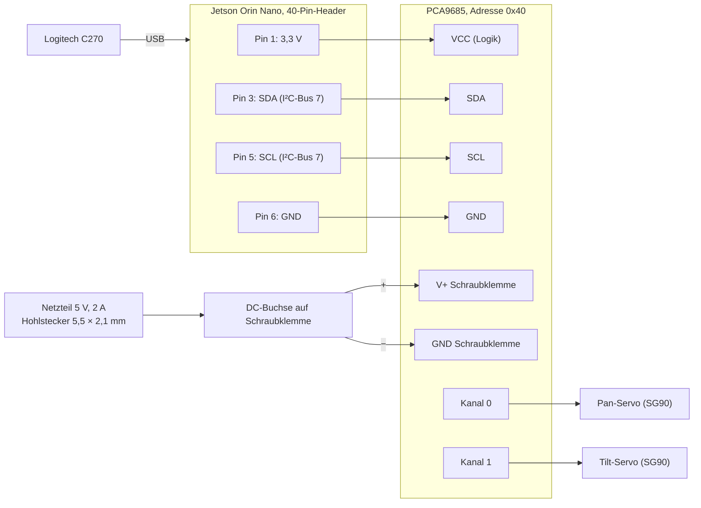

# Verkabelung

Der Jetson schickt nur Sollwinkel über I²C. Der PCA9685 erzeugt daraus die 50-Hz-Servopulse in Hardware. Die Servos bekommen ihren Strom aus einem eigenen 5-V-Netzteil und nie aus dem Jetson.

## Verbindungen

| Von | Nach | Hinweis |
|---|---|---|
| Jetson Pin 1 (3,3 V) | PCA9685 VCC | Logikspannung. Nie 5 V, weil die I²C-Pull-ups an VCC hängen und der Header nur 3,3 V verträgt. |
| Jetson Pin 3 (SDA) | PCA9685 SDA | I²C-Bus 7 unter JetPack 6 |
| Jetson Pin 5 (SCL) | PCA9685 SCL | |
| Jetson Pin 6 (GND) | PCA9685 GND | gemeinsame Masse |
| Netzteil + | PCA9685 V+ (Schraubklemme) | Servostrom. Den V+-Pin der Stiftleiste frei lassen. |
| Netzteil − | PCA9685 GND (Schraubklemme) | |
| PCA9685 Kanal 0 | Pan-Servo | braunes Kabel auf GND |
| PCA9685 Kanal 1 | Tilt-Servo | braunes Kabel auf GND |
| C270 | Jetson USB | erscheint als `/dev/video0` |

## Prüfen vor dem ersten Einschalten

1. Polarität des Netzteils mit dem Multimeter an V+ und GND des PCA9685 messen. Erwartet werden +5 V.
2. Erst den Jetson einschalten, dann das Servonetzteil.
3. I²C-Bus scannen: `sudo i2cdetect -y -r 7`. Erwartet wird die Adresse `40`.
4. Servos lose testen, ohne Kamera auf dem Halter: `python3 bionisches_auge.py --test`.
